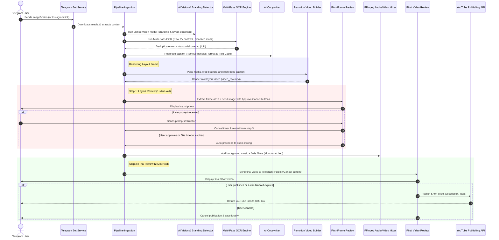

# CodeOrCap Shorts Automation Pipeline
## High-Level Design (HLD) & Workflow Architecture

This document outlines the end-to-end system design, workflow phases, and structural components of the automated 9:16 YouTube Shorts generation pipeline.

---

## 1. System Architecture Diagram

The diagram below illustrates the sequential flow of data, AI operations, user review loops, and rendering engines across the pipeline:

---

## 2. Detailed Workflow Phases

### Phase 1: Ingestion & Pre-processing
- **Sources**: Handles raw image uploads, video files, or Instagram Reel URLs via Telegraf.
- **Instagram Downloader**: Extracts dynamic media contents using `yt-dlp` and automatically stores local cookie instances.
- **Frame Extraction**: If a video source is supplied, FFmpeg extracts a keyframe at `1.0` seconds to serve as the reference frame for image analysis, branding detection, and OCR.

### Phase 2: AI Vision & Branding Detection
- **Branding Detection**: Locates creator handles, logos, watermarks, profile icons, and app overlay coordinates.
- **Watermark Masking**: Computes absolute regions to overlay Gaussian blur masks in FFmpeg (for moving videos) or solid black fills in Remotion (for static backgrounds).
- **Meme Bounding Box**: Tracks the coordinates of the top meme banner to configure safe overlay margins for the new typeset captions.

### Phase 3: Multi-Pass Deep OCR Engine
- **Pass 1 (Raw)**: Performs OCR on the default reference frame.
- **Pass 2 (Upscaled)**: Sharpens, normalizes, and upscales the frame by `2x` using `sharp` to increase detection rates for small or compressed text.
- **Pass 3 (Binarized)**: Converts the frame to grayscale and applies threshold binarization to clean complex backdrops.
- **Spatial Overlap Merge**: Computes the Intersection-over-Minimum-Area (IoU) of bounding boxes across all passes. Matches are merged, keeping the detection with the highest confidence score.

### Phase 4: AI Caption Rephrasing
- **Copywriting**: Submits the merged OCR text to the AI model to rephrase it into a high-engagement, curios-style caption.
- **Social Handle Stripping**: Automatically removes any usernames, watermarks, or text containing the `@` symbol.
- **Dynamic Override**: If a user prompt was supplied, the AI model uses the user's instructions to modify or write a custom caption override.

### Phase 5: Remotion Layout Compiling
- **Solid Mask Cover**: Applies a solid black mask (`#000000`) over the top static black portion of the video to completely cover original texts.
- **Word Highlight System**: Splits the rephrased caption into typeset rows of 4 words. Applies brand coloring system:
  - **White (`#FFFFFF`)**: Normal text.
  - **Neon Yellow (`#FFB800`)**: AI names, numbers, or tech terms with a subtle outer glow.
  - **Orange (`#FF8A00`)**: Key emphasis words.
  - **Green/Red**: Success/warning keywords.
- **Netflix Hold Animation**: Fades in (120ms), scales (95% -> 100%), holds completely steady during playback, and fades out (120ms) at the video's end.

### Phase 6: First-Frame Layout Review (1-Min Hold)
- **Review Trigger**: Extracts the frame at `1.0s` from the Remotion output video and sends it to Telegram.
- **Action Buttons**: Displays `✅ Approve Frame` and `❌ Cancel` inline buttons.
- **Timeout Timer**: Initiates a 60-second timer. If the user does not respond, the bot automatically approves the frame and continues the pipeline.
- **Prompt Interceptor**: If the user sends a text message during this review state (e.g. *"make caption funnier"*), the timer is cancelled, and the pipeline restarts from the AI rephrasing step.

### Phase 7: Video Compilation & Mixing
- **Video Duration Extraction**: Reads the exact duration of the raw cropped video using `ffprobe` to determine the precise frame rendering count, preventing freezes or padding.
- **Music Selection**: Detects the AI-vision mood ("funny", "sad", "other") and pulls a random background audio track from the corresponding assets folder.
- **FFmpeg Mix**: Blends the video track and music track together, applying volume normalization and audio fade-out filters at the end.

### Phase 8: Final Video Review (2-Min Hold)
- **Review Trigger**: Sends the compiled video to Telegram for final visual and audio review.
- **Action Buttons**: Displays `✅ Publish Now`, `❌ Cancel`, `🔄 Regenerate`, and `🎯 More Viral`.
- **Auto-Publish Timer**: Initiates a 2-minute timer. If no action is taken, the bot automatically publishes the video.

### Phase 9: Publication & Archiving
- **YouTube Upload**: Streams the final video file to the configured YouTube Shorts channel using the Google OAuth2 APIs.
- **Telegram Notification**: Sends the final YouTube Shorts URL link to the chat.
- **Local Archive**: Archives the final output MP4 in the output folder.

---

## 3. Technology Stack Summary

| Layer | Technology / Tool | Purpose |
| :--- | :--- | :--- |
| **Bot Gateway** | Telegraf / Node.js | Telegram interface & event loop |
| **Media Downloader** | yt-dlp | Instagram Reel extraction |
| **Image Pre-processing** | Sharp | Upscaling, contrast adjustments, binarization |
| **OCR Engine** | Tesseract.js | Text and bounding box extraction |
| **AI Vision / LLM** | FreeLLMAPI (Gemini/Claude) | Metadata, branding detection, and rephrasing |
| **Video Template** | Remotion / React | Typeset caption overlays and animations |
| **Media Processor** | FFmpeg / FFprobe | Video cropping, blurring, duration probing, and music mixing |
| **Publisher** | Google API Client | YouTube Shorts video publishing |
